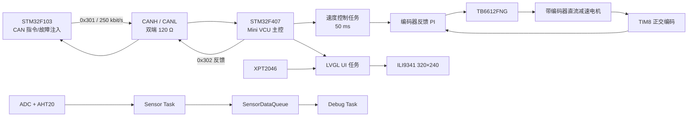
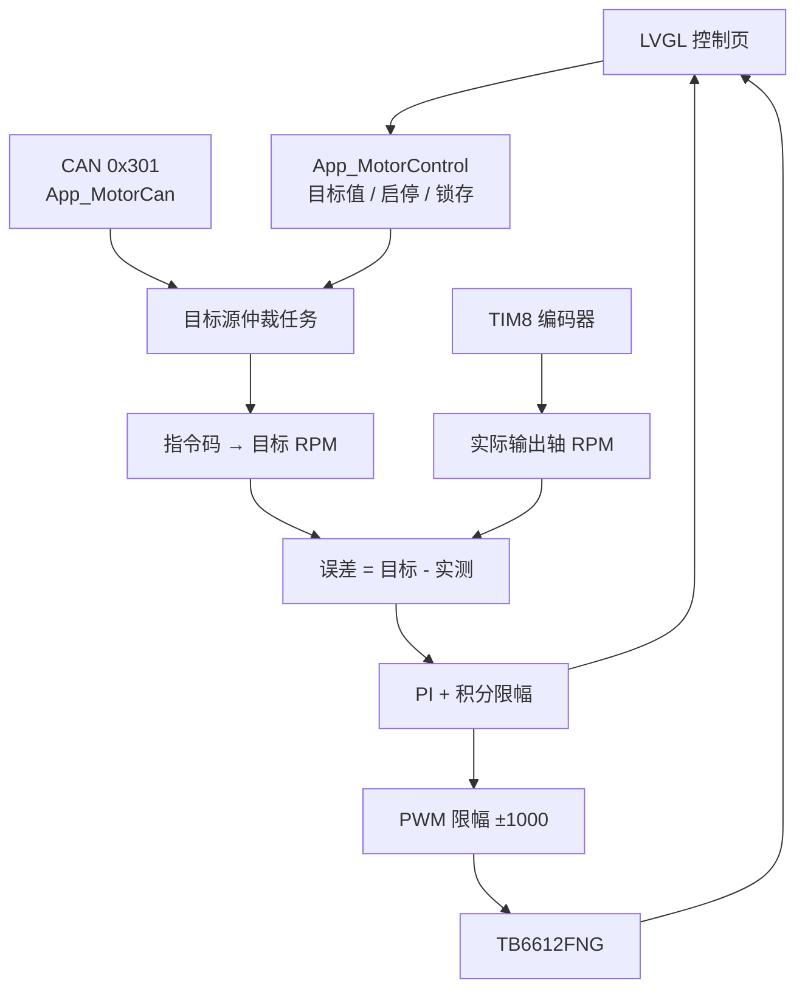

# STM32F407 Mini VCU：CAN 电机控制与 LVGL 仪表盘

基于 STM32F103C8T6 + STM32F407VGT6 的分布式车载电机控制原型。F103 通过 CAN 发送电机指令和故障注入帧，F407 完成 CAN 校验、编码器转速闭环、TB6612 电机驱动、传感器采集，以及 ILI9341 + XPT2046 + LVGL 触摸仪表盘。

> 本项目是嵌入式学习与原型验证工程，不是量产 VCU。软件急停是“停止 PWM 输出并锁存”，不是硬件安全回路；电机测试必须在空载或安全工装下进行。

## 1. 项目状态

| 项目 | 当前状态 |
| --- | --- |
| F407 工程构建 | 已重建，`0 Error(s), 0 Warning(s)` |
| 当前镜像 | RO 约 290.68 KB，RW 508 B，ZI 118,224 B，ROM 约 290.98 KB |
| 显示 | ILI9341 320×240 横屏，RGB565 |
| 触摸 | XPT2046，原始坐标映射并注册为 LVGL 输入设备 |
| LVGL | 主页、控制页、触摸按钮、真实状态刷新 |
| 本地控制 | START / STOP / ±10 RPM 调速 / E-STOP / RESET |
| 电机闭环 | TIM8 编码器反馈 + 50 ms 速度 PI + TIM3_CH3 PWM |
| CAN 控制 | F103 → F407，`0x301`，250 kbit/s |
| CAN 反馈 | F407 → F103，`0x302` |
| 已有上板记录 | LCD 图形、字符、触摸、页面、本地启停和状态联动 |
| 仍需补强 | 编码器标定、实时性测量、故障注入回归、硬件急停 |

当前镜像为带调试信息的构建结果，释放构建后体积可能不同。

## 2. 系统架构



控制优先级从高到低：

```text
E-STOP 锁存 > STOP 锁存 > 本地触摸控制 > F103 CAN 指令
```

LVGL 回调只修改控制请求，不直接写 PWM；最终电机输出由 `Motor_CAN` 任务统一管理。

## 3. 控制与显示链路



### 3.1 本地控制

- `START`：清除停机/急停锁存，进入本地控制并设定目标速度。
- `STOP`：目标清零、PWM 清零并置停机锁存；F103 后续 SET 帧不能重新启动。
- `+ / -`：每次调整 10 RPM，范围 `-150 ~ +150 RPM`；运行中实时生效。
- `E-STOP`：最高优先级停机并锁存，置位 `FAULT_EMERGENCY_STOP`。
- `RESET`：若急停锁存则释放急停；否则释放普通停机锁存并交还 CAN。

### 3.2 速度闭环

当前实际生效的是 `freertos.c` 内的速度 PI，不是工程中未被任务调用的 `App_SpeedPID.c`。

| 参数 | 当前值 |
| --- | ---: |
| CAN 指令范围 | `-1000 ~ +1000` |
| 映射最大转速 | `169 RPM` |
| 控制周期 | `50 ms` |
| `Kp` | `10.0` |
| `Ki` | `1.0` |
| 积分限幅 | `±400` |
| PWM 限幅 | `±1000` |
| 积分重置阈值 | 目标变化超过 `5 RPM` |

- CAN 指令 `+100` 对应目标约 `+16.9 RPM`，`+200` 对应 `+33.8 RPM`。
- 实际转速来自 TIM8 编码器，代码按每电机转 `11` 脉冲、4 倍频、减速比 `35.5` 换算。
- 编码器参数仍是标定假设，绝对 RPM 精度需要用外部测速仪或已知转数验证。
- 电机为零目标时停止 PWM、清积分；目标大幅变化时仅重置积分，没有目标 RPM 斜坡。

## 4. 硬件与屏幕接线

### 4.1 显示与触摸

LCD 与触摸均使用 GPIO 模拟 SPI，不占用 F407 的硬件 SPI 外设。

| 模块 | 模块引脚 | F407 引脚 | 方向/说明 |
| --- | --- | --- | --- |
| ILI9341 | `SCK` | `PC0` | MCU → LCD，时钟 |
| ILI9341 | `SDI / MOSI` | `PC1` | MCU → LCD，数据 |
| ILI9341 | `CS` | `PC3` | MCU → LCD，片选 |
| ILI9341 | `D/C` | `PC4` | 命令/数据选择 |
| ILI9341 | `RESET` | `PC5` | 复位，低有效 |
| ILI9341 | `LED` | `3.3 V` | 当前记录为常亮；量产应增加限流/开关控制 |
| ILI9341 | `SDO / MISO` | 未连接 | 当前只写显示，不读回 |
| XPT2046 | `T_CLK` | `PB5` | 触摸 SPI 时钟 |
| XPT2046 | `T_CS` | `PB15` | 触摸片选 |
| XPT2046 | `T_DIN` | `PB4` | MCU → 触摸控制器 |
| XPT2046 | `T_DO` | `PB3` | 触摸控制器 → MCU |
| XPT2046 | `T_IRQ` | 未使用 | 当前按周期查询 |
| 两模块 | `GND` | `GND` | 必须与 MCU 共地 |
| 两模块 | `VCC` | 按模块要求 | 原记录中 ILI9341 模块接 5 V；不得把 5 V 逻辑直接送入 F407 |

接线注意事项：

- 原记录中显示模块 `VCC=5 V`，而 MCU 逻辑电平为 3.3 V。接线前必须确认模块是否自带稳压和电平转换。
- 背光直接接 3.3 V 只适用于当前模块；长期使用应确认背光限流和驱动能力。
- 触摸和显示使用两组独立片选，不能把 `PC3` 与 `PB15` 短接。
- 若更换屏幕批次，需重新核对颜色顺序、旋转方向和触摸原始坐标范围。

### 4.2 主控与其他外设

| 功能 | F407 引脚 | 说明 |
| --- | --- | --- |
| CAN1_RX / TX | `PA11 / PA12` | 经 CAN 收发器接 CANH/CANL，250 kbit/s |
| USART1 | `PA9 / PA10` | 调试串口，115200 8N1 |
| AHT20 | `PB6 / PB7` | I2C1，7 位地址 `0x38` |
| ADC | `PA0` | ADC1_IN0，12 位 |
| LED | `PA5` | 500 ms 翻转 |
| 编码器 A / B | `PC6 / PC7` | TIM8 正交编码器 |
| TB6612 PWM | `PB0` | TIM3_CH3，约 1 kHz |
| TB6612 AIN1 / AIN2 | `PB12 / PB13` | 正反转方向 |
| TB6612 STBY | `PB14` | 高电平使能 |

## 5. CAN 协议

### 5.1 当前控制链

| 帧 | 方向 | ID | DLC | 作用 |
| --- | --- | ---: | ---: | --- |
| 电机控制 | F103 → F407 | `0x301` | 8 | SET / STOP |
| 电机反馈 | F407 → F103 | `0x302` | 8 | 接收结果、目标值、状态和故障 |

经典 CAN 2.0A，标准数据帧，11 位 ID，250 kbit/s。

### 5.2 `0x301` 电机控制帧

| 字节 | 字段 | 取值 | 说明 |
| --- | --- | --- | --- |
| `Data[0]` | 帧标记 | `0xA5` | 非法则 `BAD_FRAME` |
| `Data[1]` | 命令 | `0x01` / `0x02` | SET / STOP |
| `Data[2]` | 速度高字节 | `0x00~0xFF` | 有符号 int16 高字节 |
| `Data[3]` | 速度低字节 | `0x00~0xFF` | 有符号 int16 低字节 |
| `Data[4]` | 序号 | `0x00~0xFF` | F103 递增，F407 当前不消费 |
| `Data[5..7]` | 保留 | 0 | 当前未使用 |

速度采用大端，合法范围 `-1000 ~ +1000`。

示例：

| 含义 | 完整数据 |
| --- | --- |
| SET +100 | `A5 01 00 64 SS 00 00 00` |
| SET -300 | `A5 01 FE D4 SS 00 00 00` |
| STOP | `A5 02 00 00 SS 00 00 00` |

`SS` 为发送序号，由 F103 递增。

### 5.3 `0x302` 电机反馈帧

| 字节 | 字段 | 说明 |
| --- | --- | --- |
| `Data[0]` | 帧标记 | `0xA5` |
| `Data[1]` | 状态 | `0x00 IDLE`、`0x01 SET_ACCEPTED`、`0x02 STOP_ACCEPTED`、`0x80 FAULT` |
| `Data[2..3]` | 目标值 | int16 大端，指令值 `-1000 ~ +1000` |
| `Data[4]` | 最后命令 | SET 或 STOP |
| `Data[5]` | 序号 | 回显对应命令序号 |
| `Data[6]` | 故障码 | `0 NONE`、`1 TIMEOUT`、`2 BAD_COMMAND`、`3 BAD_DATA`、`4 E-STOP` |
| `Data[7]` | 保留 | 0 |

### 5.4 保留的通用协议

| ID | 用途 | DLC | 当前状态 |
| --- | --- | ---: | --- |
| `0x100` | 心跳 | 2 | 仅协议监视 |
| `0x101` | 传感器数据 | 8 | 仅协议监视 |
| `0x200` | 控制命令 | 4 | 小端，当前不驱动电机 |
| `0x201` | 状态回报 | 4 | 仅协议监视 |

F103 的 `0x123/0x124` 也是旧协议代码，当前测试任务未调用，不属于当前控制链。

### 5.5 故障与超时

| 故障位 | 值 | 触发条件 |
| --- | ---: | --- |
| `FAULT_CAN_TIMEOUT` | `0x01` | 超过 500 ms 没有合法 `0x301` |
| `FAULT_CAN_BAD_FRAME` | `0x02` | DLC 不是 8 或帧头不是 `0xA5` |
| `FAULT_CAN_BAD_COMMAND` | `0x04` | 命令不是 SET/STOP |
| `FAULT_CAN_BAD_SPEED` | `0x08` | SET 速度越界 |
| `FAULT_EMERGENCY_STOP` | `0x10` | 触摸 E-STOP 锁存 |

非法控制帧不会覆盖上一条合法目标，也不会刷新最后接收时刻；若随后没有合法帧，500 ms 超时会使目标归零。故障位可以叠加。

## 6. 软件模块与 FreeRTOS 任务

### 6.1 模块职责

| 层级 | 模块 | 职责 |
| --- | --- | --- |
| 显示 | `lcd_ili9341.c/.h` | ILI9341 初始化、区域绘制、RGB565 刷屏 |
| 触摸 | `Int_XPT2046.c/.h` | GPIO 模拟 SPI、X/Y/Z 采样 |
| 触摸适配 | `App_Touch.c/.h` | 原始坐标映射、注册 LVGL pointer 输入 |
| UI | `App_lcd_ui.c/.h` | 主页/控制页、控件和 LVGL 事件 |
| LVGL 移植 | `lv_port_disp.c` | 320×240 RGB565 显示注册与 flush |
| 本地控制 | `App_MotorControl.c/.h` | 目标速度、启停、急停及锁存状态 |
| CAN 控制 | `App_MotorCan.c/.h` | `0x301` 校验、目标值、最后接收时间 |
| CAN 反馈 | `App_MotorFeedback.c/.h` | 发送 `0x302` 状态与故障 |
| 故障 | `App_Fault.c/.h` | 32 位故障标志的原子置位/清除 |
| CAN 驱动 | `Int_can.c/.h` | CAN1 启动、过滤器、发送、FIFO0 中断 |
| 电机驱动 | `Int_motor.c/.h` | TIM3 PWM、方向、STBY、停止 |
| 编码器 | `Int_Encoder.c/.h` | TIM8 计数差与输出轴 RPM |
| 传感器 | `App_data` / `Int_aht20` | ADC、AHT20 和队列数据结构 |
| 任务层 | `Core/Src/freertos.c` | 任务创建、控制仲裁、PI、UI 刷新 |

### 6.2 任务配置

| 任务 | 优先级 | 栈 | 周期/阻塞 | 职责 |
| --- | --- | ---: | --- | --- |
| `Motor_CAN` | High | 4 KB | 50 ms | 目标源仲裁、编码器、PI、PWM、超时 |
| `Sensor_Task` | Normal | 3 KB | 500 ms | ADC + AHT20，写入队列 |
| `Debug_Task` | Normal | 3 KB | 队列阻塞 | 消费传感器数据 |
| `LED_Task` | Low | 1 KB | 500 ms | 状态灯 |
| `lcdTask` | Low | 8 KB | 5 ms 循环 | LVGL、触摸、200 ms 数据刷新 |
| `defaultTask` | Normal | 512 B | 1 ms | 空壳任务 |

FreeRTOS tick 为 1000 Hz；F407 FreeRTOS heap 为 24 KB。

## 7. LVGL 与界面

### 7.1 显示配置

| 项目 | 当前配置 |
| --- | --- |
| 分辨率 | `320 × 240` |
| 颜色格式 | RGB565，16 bit |
| LVGL 内存池 | 80 KB |
| 默认刷新周期 | 33 ms |
| 渲染缓冲 | 单缓冲，10 行，6400 B |
| 刷新方式 | 同步 GPIO 模拟 SPI 区域写入 |
| LVGL OS 模式 | `LV_OS_NONE` |
| `lv_timer_handler()` | 仅在 `lcdTask` 中调用 |

### 7.2 页面

**主页**

- `MOTOR SPEED`：编码器实测转速。
- `TGT`：目标转速。
- `MOTOR STATUS`：`RUNNING / STOPPED / E-STOP`。
- `PWM`：真实 PWM 指令换算的百分比。
- `CAN`：在线/离线、最近 ID、DLC、数据、接收计数。
- `FAULT`：当前故障位摘要。

**控制页**

- 三行两列大按钮：`START / STOP`、`- / +`、`E-STOP / RESET`。
- 单按钮高度 34 px，页面禁止滚动，降低误触和命中困难。
- 状态卡显示 `TGT / MOTOR / ACT / PWM / TX`。
- UI 每 200 ms 刷新一次，不在 CAN 中断中绘图。

### 7.3 LVGL 接入中解决的问题

- 2 KB 的 UI 任务栈在 LVGL 渲染时溢出，任务栈提升到 8 KB。
- 主页原先显示静态演示值，最终改为目标转速、编码器实际转速、PWM 和真实运行状态。
- 浮点格式化在设备端显示乱码，速度显示改为整数 `%d`。
- 页面原可滚动且按钮拥挤，最终禁用滚动并重排为三行两列大按钮。
- 普通 STOP 与 E-STOP 使用不同锁存优先级，`RESET` 负责释放并交还 CAN。

## 8. 构建与烧录

### 8.1 环境

- Keil MDK Professional 5.37
- ARM Compiler 5.06 update 7
- Keil STM32F4xx DFP 2.16.0
- STM32CubeMX 生成 HAL + CMSIS-RTOS2

### 8.2 构建

1. 打开 `MDK-ARM/F407_Main.uvprojx`。
2. 选择目标 `F407_Main`，执行 Rebuild。
3. 确认输出 `0 Error(s), 0 Warning(s)`。
4. 生成位于 `MDK-ARM/F407_Main/F407_Main.hex`。

命令行示例：

```powershell
& "C:\Keil_v5\UV4\UV4.exe" -b `
  "MDK-ARM\F407_Main.uvprojx" `
  -j0 -o "MDK-ARM\build_f407.log"
```

### 8.3 烧录

- 通过 ST-Link/SWD 烧录 F407。
- F103 发送端工程位于相邻目录 `../../F103_Node`。
- 首次联调建议只烧录 F407，在断开电机 VM 电源的情况下验证显示和触摸。

## 9. 测试步骤

### 9.1 测试前安全检查

1. 拆除电机负载或把电机架空。
2. 首次上电断开 TB6612 的 VM 电机电源，只保留逻辑供电。
3. 确认 LCD、触摸、CAN 收发器和 MCU 共地。
4. 核对屏幕模块供电和逻辑电平，禁止把 5 V 信号直接送入 F407。
5. 准备万用表、逻辑分析仪/示波器和 CAN 分析仪。

### 9.2 显示与触摸

1. 烧录 F407，观察屏幕是否完成白屏/彩屏初始化。
2. 进入主页，确认没有花屏、错位或彩色噪点。
3. 点击 `CONTROL` 和 `HOME`，确认页面切换稳定。
4. 依次点击四角和中心，确认坐标方向正确、边缘不偏移。
5. 按住按钮并滑动，确认页面不滚动，按钮不会重复触发。

**预期**：320×240 横屏正确，触摸位置与控件一致，页面固定。

### 9.3 LVGL 本地控制

1. 在控制页设置目标 `+30 RPM`，按 `START`。
2. 观察 `MOTOR` 是否变为 `RUNNING`，`TGT`、`ACT`、`PWM` 是否更新。
3. 点击 `+ / -`，确认每次变化 10 RPM，且不超 `±150 RPM`。
4. 按 `STOP`，确认目标清零、PWM 归零、状态变为 `STOPPED`。
5. 保持 F103 发送 SET 帧，确认 STOP 锁存阻止电机重新启动。
6. 按 `RESET`，确认释放锁存并交还 CAN。
7. 按 `E-STOP`，确认立即停 PWM、状态显示 `E-STOP`、外部 CAN 目标不能重新启动。
8. 按 `RESET` 后再次 `START`，确认可以恢复。

**预期**：LVGL 回调只更新请求，不直接操作 PWM；目标、实际转速、PWM 和状态来自控制任务。

### 9.4 CAN 控制与反馈

1. 用 CAN 分析仪发送合法 `0x301`：`A5 01 00 64 00 00 00 00`。
2. 确认 F407 接收计数增加，CAN 状态变为在线。
3. 断开 F103 或停止发送，等待超过 500 ms。
4. 确认目标归零、电机停转、界面显示 CAN 超时。
5. 恢复合法帧，确认故障恢复并重新接受目标。
6. 观察 F407 是否发送 `0x302`，核对状态、目标值、命令、序号和故障码。

### 9.5 非法帧注入

| 用例 | 发送内容 | 预期 |
| --- | --- | --- |
| DLC 错误 | `0x301`、DLC=7 | `BAD_FRAME=0x02` |
| 帧头错误 | DLC=8、`Data[0]!=A5` | `BAD_FRAME=0x02` |
| 命令错误 | `Data[1]=0x03` | `BAD_COMMAND=0x04` |
| 速度越界 | SET、速度 `+1001/-1001` | `BAD_SPEED=0x08` |
| 链路超时 | 停止所有合法帧 >500 ms | `TIMEOUT=0x01` |

故障位可以叠加。例如串口/调试器看到 `0x03`，表示 `BAD_FRAME | TIMEOUT`，不要误判为单一故障码。

### 9.6 回归测试

- CAN 接收、PI 和 PWM 与 LVGL 页面刷新同时运行时无阻塞。
- 反复切换主页/控制页不崩溃、不重启。
- 反复启停、急停/复位不少于 100 次。
- 传感器任务、LED 任务和调试队列正常运行。
- 记录连续运行时间、任务栈高水位、FreeRTOS 剩余堆和 LVGL 内存使用。

## 10. 已有测试记录与证据边界

| 项目 | 已有记录 | 说明 |
| --- | --- | --- |
| F407 当前构建 | 0 error / 0 warning | 日志：`MDK-ARM/F407_Main/F407_Main.build_log.htm` |
| LCD 基础图形/字符 | 已上板 | Day 2 记录 |
| XPT2046 原始坐标 | 已上板 | Day 3 记录 |
| LVGL 页面与触摸 | 已完成 | Day 4 记录 |
| 本地启停、调速、急停/复位 | 记录中标记完成 | 需继续保留复现日志 |
| CAN 双节点通信 | 已建立 | Day 13 记录 |
| CAN DLC 错误 | 已注入 | 观察到故障位叠加 |
| 帧头/命令/速度越界 | 部分未归档 | 不能声称全部完成 |
| 编码器绝对 RPM 标定 | 未完成 | 11 脉冲 ×4、减速比 35.5 仍为假设 |
| 实时性/FPS/触摸精度 | 未量化 | 尚无逻辑分析仪或性能统计报告 |

## 11. 已知限制

- LCD 和触摸都是 GPIO 模拟 SPI，显示 flush 是同步阻塞写入，刷屏会占用 UI 任务时间。
- LVGL 使用单缓冲和 10 行局部刷新，没有 DMA/双缓冲；复杂动画或高刷新率会受限。
- LVGL 配置为 `LV_OS_NONE`，所有 LVGL API 必须保持在 `lcdTask` 上下文，不能从 CAN 中断直接调用。
- LVGL 内存池固定 80 KB，UI 任务栈 8 KB；当前缺少正式的高水位和碎片统计。
- 触摸校准使用固定原始坐标范围，没有运行中校准、参数存储或温漂补偿。
- 字体没有中文字库，界面主要使用英文。
- 软件 E-STOP 只清除 PWM 和方向输出并锁存，不是硬件断电/抱闸安全回路。
- 速度环实际为 PI，不是完整 PID；没有目标 RPM 斜坡、电流环和负载观测。
- 编码器 `11 × 4` 计数和 `35.5` 减速比尚未完成绝对标定，也没有编码器断线故障位。
- `App_SpeedPID.c` 未被当前任务调用，当前参数位于 `freertos.c`，存在后续维护分叉风险。
- CAN 初始化使用全通掩码，所有标准/扩展帧都会进入软件中断；量产时应缩小过滤器范围。
- `0x301` 非法帧不会立即停车，要等下一帧合法指令或 500 ms 超时；若需要立即停车，应增加独立安全帧或硬件联锁。
- `0x100/0x101/0x200/0x201` 和 F103 `0x123/0x124` 是保留/旧协议，不参与当前电机控制。
- 触摸任务与 LVGL 输入读取都可能查询 XPT2046，存在重复采样；当前可用，但可进一步收敛。
- 项目没有 CI、自动化硬件测试、总线误码率和长时间稳定性报告。

## 12. 目录与文档

```text
F407_Main/
├─ Core/                         # CubeMX、FreeRTOS、CAN/TIM/ADC/I2C 初始化
├─ Drivers/                      # STM32F4 HAL/CMSIS
├─ Middlewares/                  # FreeRTOS
├─ MDK-ARM/
│  ├─ Application/               # UI、控制、CAN 协议、故障
│  ├─ Interface/                 # LCD、触摸、CAN、电机、编码器
│  ├─ LVGL/                      # LVGL 源码、配置与移植
│  ├─ USER/                      # 旧版 ILI9341/字体驱动
│  └─ F407_Main.uvprojx
├─ README.md                     # 本文，项目最终说明
├─ RESUME_INTERVIEW.md           # 简历描述、讲解稿和面试问答
├─ 2阶段Day1_LCD_FreeRTOS开发记录.md
├─ 2阶段Day2_Mini_VCU_LCD_开发记录.md
├─ 2阶段Day 3：XPT2046 触摸驱动与原始坐标映射.md
└─ 2阶段Day4_LVGL本地电机控制与仪表盘整合总结.md
```

Day 1～Day 4 文档保留为过程记录；功能、接口和限制以本 README 为准。

## 13. 面试与简历材料

简历条目、一分钟介绍、五分钟讲解、关键设计取舍和常见追问见 [RESUME_INTERVIEW.md](RESUME_INTERVIEW.md)。

## 14. 安全声明

- 本项目不是功能安全或量产级 VCU。
- 不得把软件 PWM 归零描述为硬件急停。
- 首次电机测试应空载，之后使用低目标值和限流电源。
- CAN、TB6612、电机电源和 MCU 必须正确共地，电机电源不可直接使用 MCU 的 3.3 V 或 USB 供电。
- 屏幕模块供电、逻辑电平和背光限流必须以实际模块原理图为准。
