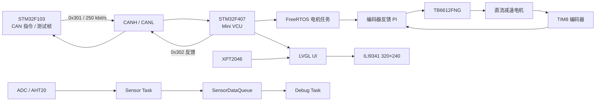

# Mini VCU：STM32F103 + STM32F407 分布式电机控制

这是一个由两块 STM32 组成的 CAN 电机控制与 LVGL 仪表盘项目：

- **F103_Node**：CAN 指令发送端和故障注入端，每 50 ms 发送一帧标准数据帧 `0x301`。
- **F407_Main**：Mini VCU 主控，完成 CAN 校验、目标源仲裁、编码器速度 PI、TB6612 驱动、故障保护、传感器采集和 ILI9341 + XPT2046 + LVGL 触摸界面。

项目适合演示嵌入式系统中“通信、实时控制、故障安全、显示交互”四条链路的整合，但不是量产或功能安全 VCU。

## 系统结构



控制源优先级：

```text
E-STOP 锁存 > STOP 锁存 > 本地触摸控制 > F103 CAN 指令
```

## 主要功能

| 功能 | 当前实现 |
| --- | --- |
| CAN 双节点 | 经典 CAN 2.0A，250 kbit/s，F103/F407 两端 |
| 电机控制帧 | `0x301`，DLC=8，SET/STOP、有符号速度、序号 |
| 电机反馈帧 | `0x302`，DLC=8，状态、目标、命令、序号、故障码 |
| 帧校验 | ID、DLC、帧头、命令、速度范围逐级检查 |
| 超时保护 | 500 ms 无合法 `0x301`，目标归零并置故障位 |
| 转速闭环 | TIM8 编码器 + 50 ms PI + TIM3_CH3 PWM |
| 电机驱动 | TB6612FNG，方向、PWM、STBY |
| 传感器 | PA0 ADC + AHT20，通过消息队列交给调试任务 |
| 显示 | ILI9341，320×240，RGB565 |
| 触摸 | XPT2046，GPIO 模拟 SPI，LVGL pointer 输入 |
| GUI | 主页、控制页、状态卡、故障/CAN 信息 |
| 本地控制 | START/STOP、±10 RPM、±150 RPM 限幅、E-STOP、RESET |
| FreeRTOS | 1000 Hz tick；电机、传感器、调试、LED、LCD 任务 |

## CAN 协议摘要

### `0x301` 电机控制

| 字节 | 内容 |
| --- | --- |
| `Data[0]` | `0xA5` 帧标记 |
| `Data[1]` | `0x01` SET / `0x02` STOP |
| `Data[2..3]` | int16 速度，大端，`-1000 ~ +1000` |
| `Data[4]` | 序号 |
| `Data[5..7]` | 保留 |

### `0x302` 电机反馈

| 字节 | 内容 |
| --- | --- |
| `Data[0]` | `0xA5` |
| `Data[1]` | `0x00` IDLE / `0x01` SET_ACCEPTED / `0x02` STOP_ACCEPTED / `0x80` FAULT |
| `Data[2..3]` | int16 目标值，大端 |
| `Data[4]` | 最后命令 |
| `Data[5]` | 序号回显 |
| `Data[6]` | 故障码：0 NONE、1 TIMEOUT、2 BAD_COMMAND、3 BAD_DATA、4 E-STOP |
| `Data[7]` | 保留 |

`0x100/0x101/0x200/0x201` 和 F103 `0x123/0x124` 是保留或旧协议代码，不参与当前电机控制链。

## 目录

```text
Mini_VCU/
├─ F103_Node/                    # F103 CAN 发送端
├─ F407_Main/                    # F407 主控与 LVGL GUI
│  ├─ Core/
│  ├─ Drivers/
│  ├─ Middlewares/
│  ├─ MDK-ARM/
│  ├─ README.md                  # F407 最终项目说明
│  └─ RESUME_INTERVIEW.md        # 简历与面试材料
├─ docs/                         # 系统级协议、接线、架构和测试记录
├─ README.md                     # 本文，系统总览
└─ STM32_CAN_电机转速闭环控制阶段总结.md
```

## 快速开始

1. 先阅读 [F407_Main/README.md](F407_Main/README.md)，确认屏幕、CAN、电机和供电接线。
2. 打开 `F407_Main/MDK-ARM/F407_Main.uvprojx`，Rebuild。
3. 打开 `F103_Node/MDK-ARM/F103_Node.uvprojx`，Rebuild。
4. 首次测试断开 TB6612 的 VM 电机电源，只验证显示、触摸和 CAN。
5. 确认逻辑和总线正常后，再接电机做低目标值空载测试。

## 构建状态

当前 F407 LVGL 版本已用 Keil MDK 5.37 / ARMCC 5.06 重建：

```text
0 Error(s), 0 Warning(s)
RO ≈ 290.68 KB
RW = 508 B
ZI = 118,224 B
ROM ≈ 290.98 KB
```

F407VGT6 具备 1 MB Flash 和 192 KB SRAM，当前镜像仍有资源余量，但显示和 LVGL 内存仍需做长时间与高水位测量。

## 测试状态

| 项目 | 状态 |
| --- | --- |
| F407 当前构建 | 通过，0 error / 0 warning |
| LCD 基础图形/字符 | Day 2 已有上板记录 |
| XPT2046 触摸 | Day 3 已有原始坐标与映射记录 |
| LVGL 页面/触摸 | Day 4 已有整合记录 |
| 本地启停、调速、急停/复位 | Day 4 记录标记完成，建议持续回归 |
| CAN 双节点 | Day 13 已建立 |
| CAN 非法帧 | 部分已注入，完整矩阵未归档 |
| 编码器绝对 RPM | 未用外部测速仪校准 |
| 实时性、FPS、触摸精度 | 未量化 |

详细证据和限制见 [F407_Main/README.md](F407_Main/README.md) 与 [docs/test_report.md](docs/test_report.md)。

## 当前限制

- LCD/触摸使用 GPIO 模拟 SPI，显示为同步区域写入，没有 DMA/双缓冲。
- LVGL 在单一低优先级任务中运行，未启用 LVGL OS 模式。
- 当前速度环是 PI，不是完整 PID；没有目标 RPM 斜坡和电流环。
- 编码器每转计数和减速比仍需标定，未增加编码器失效故障位。
- 软件 E-STOP 不是硬件安全回路。
- 触摸校准参数固定，没有运行时校准和参数持久化。
- 旧 CAN 协议和未使用的 `App_SpeedPID.c` 仍留在工程中，需要后续归档。

## 文档

- [F407 项目最终 README](F407_Main/README.md)
- [简历与面试问答](F407_Main/RESUME_INTERVIEW.md)
- [CAN 协议](docs/can_protocol.md)
- [硬件接线](docs/hardware_wiring.md)
- [软件架构](docs/software_architecture.md)
- [测试报告](docs/test_report.md)
- [F103 发送端说明](F103_Node/README.md)

## 安全声明

首次电机测试应拆除负载、断开 VM 电源或使用限流电源。CAN 收发器、TB6612、电机电源和 MCU 必须正确共地；禁止用 MCU 的 3.3 V 或 USB 直接给电机供电。屏幕模块的 5 V/3.3 V 供电和逻辑电平必须以实际模块原理图为准。
